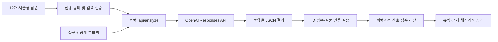
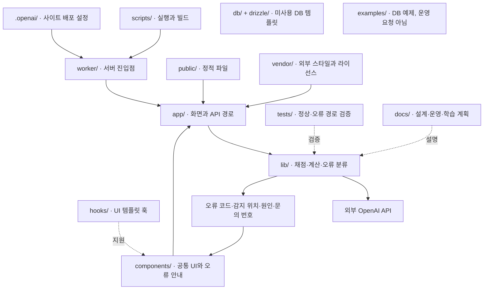

# 사이 · SAI

### 선택지 사이에 담기지 않았던, 나의 이야기

**서술형 답변과 공개 채점기준으로 성향을 탐색하는 한국어 AI 웹 서비스.**

12개의 일상 상황에 자유롭게 답하면, LLM이 행동과 선택 이유를 읽고 E/I · S/N · T/F · J/P 네 가지 선호를 분석합니다. 결과뿐 아니라 답변 속 근거, 문항별 점수, 계산 기준까지 함께 공개합니다.

> 현재는 OpenAI API를 이용하는 MVP입니다. 향후 실제 트래픽과 요청당 비용을 측정하고, 도메인에 맞게 오픈소스 LLM을 파인튜닝하여 자체 추론 서버로 전환하는 방안을 검증할 예정입니다. 전환 여부는 API 대비 품질·지연 시간·총 운영비를 비교해 결정합니다.

[배포 사이트](https://between-lines-mbti-inho.beigecove3.chatgpt.site) · [개발 로드맵](docs/ROADMAP.md)

배포 사이트는 현재 소유자 전용입니다. GitHub 저장소에 코드를 올리는 것과 사이트 접근 권한은 별개입니다.

## 프로젝트를 만든 이유

선택형 검사에서는 같은 선택지를 고른 사람도 서로 다른 이유를 가질 수 있습니다. 이 프로젝트는 “무엇을 선택했는가”에 “왜 그렇게 행동했는가”를 더해, 사용자의 맥락을 함께 해석하는 경험을 실험합니다.

장기적으로는 서비스에서 발생하는 추론 비용과 트래픽을 관찰하고, 채점 작업에 특화된 작은 모델이 상용 API를 어느 범위까지 대체할 수 있는지 평가하는 프로젝트로 발전시키려 합니다.

## 주요 기능

- **12개 서술형 문항:** 네 선호 축마다 서로 다른 상황 3개씩 구성
- **한 번의 채점 요청:** 질문·전체 답변·공개 루브릭을 한 번의 API 호출로 전달
- **구조화된 출력:** 문항별 점수, 근거 여부, 원문 인용, 한국어 해설
- **서버 측 검증:** 점수 범위·문항 ID·원문 인용 여부를 확인한 뒤 선호를 계산
- **공개 채점기준:** 결과 화면과 별도의 기준 페이지에서 확인
- **판단 보류:** 근거가 부족하거나 양쪽 선호가 비슷한 축은 `?`로 표시
- **응답 전송 동의 및 선택적 임시 저장:** 답변의 DB 수집 없이 시작하는 MVP
- **모바일 화면 및 예시 결과:** 실제 채점 결과와 예시를 명확히 구분

<details>
<summary>화면 미리보기</summary>
<br>

</details>

## 현재 구현 상태

| 항목 | 상태 |
| --- | --- |
| 소개·질문 작성·공개 기준·결과 화면 | 구현 및 화면 확인 |
| API 요청, 구조화된 출력, 결과 검증 | 구현 |
| 타입 검사와 프로덕션 빌드 | 통과 |
| 점수 방향·경계·근거 부족 처리 | 검증 |
| 필수 답변·전송 동의 검증 | 검증 |
| 실제 API 호출 | 잔액 부족 응답까지 확인 |
| 실제 모델 결과를 받아 끝까지 성공하는 검사 | API 잔액 충전 후 검증 예정 |
| 학습 데이터 수집·파인튜닝·자체 모델 서빙 | 계획 단계 |

위 상태는 초기 구현 검증 시점의 기록입니다. API 연결 코드가 있다는 것과 실제 채점 성공 검증을 마쳤다는 것을 구분합니다. 측정하지 않은 품질·정확도·비용 절감 수치는 제시하지 않습니다.

## 동작 구조



LLM은 답변의 해석과 문항별 채점을 담당합니다. 최종 선호 계산은 서버의 명시적인 규칙으로 수행합니다. 사용자 답변 안의 채점 변경 지시는 따르지 않도록 프롬프트에 구분해 전달합니다. 이는 지시 주입에 대한 완전한 방어를 보장하지 않으며 별도 평가가 필요합니다.

## 채점 방식

각 축의 왼쪽은 E/S/T/J, 오른쪽은 I/N/F/P입니다.

| 문항 점수 | 해석 |
| --- | --- |
| −2 | 왼쪽 선호를 구체적인 이유와 반복 행동으로 뒷받침 |
| −1 | 왼쪽 선호의 약하거나 상황적인 근거 |
| 0 | 양쪽 균형·상충 또는 근거 부족 |
| +1 | 오른쪽 선호의 약하거나 상황적인 근거 |
| +2 | 오른쪽 선호를 구체적인 이유와 반복 행동으로 뒷받침 |

1. 해당 축의 근거 있는 답변만 동일 가중치로 평균합니다.
2. 근거가 있는 답변이 2개 미만이면 판단을 보류합니다.
3. 평균이 −0.5 이하이면 왼쪽, +0.5 이상이면 오른쪽 선호입니다. 그 사이는 경계로 표시합니다.
4. 오른쪽 선호 점수는 `50 + 평균 × 25`로 나타냅니다.

이 수치는 채점 결과의 위치이며 확률이나 검사의 정확도가 아닙니다. 글자 수와 문장력 자체에는 점수를 주지 않습니다. 질문과 루브릭의 실제 정의는 [`lib/assessment.ts`](lib/assessment.ts)에 있습니다.

## 기술 구성

| 영역 | 현재 구현 |
| --- | --- |
| UI | React 19 · TypeScript · CSS |
| 애플리케이션 | Vinext/Vite 기반 Next.js App Router 호환 구성 |
| API | 서버 라우트 · OpenAI Responses API · JSON Schema |
| 입력 검증 | Zod |
| 기본 모델 | `gpt-4.1-mini` (`OPENAI_MODEL`로 설정) |
| 호스팅 | Sites · Cloudflare Workers |
| 데이터 저장 | DB 저장 없음 · 선택적 `sessionStorage` |

FastAPI, PostgreSQL, LoRA/QLoRA, vLLM은 현재 구현된 구성요소가 아닙니다. 향후 실험 단계에서 필요성을 검토합니다.

## 로컬 실행

Node.js **22.13 이상**과 사용 가능한 OpenAI API 키 및 API 잔액이 필요합니다.

```bash
git clone https://github.com/valentinho02/sai-mbti.git
cd sai-mbti
npm ci
cp .env.example .env.local
```

`.env.local`의 `OPENAI_API_KEY`를 로컬 편집기로 설정합니다. 키를 README, 소스 코드, 커밋 또는 이슈에 넣지 마세요. ChatGPT 구독과 API 사용 잔액은 별도입니다.

```bash
npm run dev
```

기본 미리보기 주소는 `http://127.0.0.1:5173`입니다. 실행 시 출력된 주소를 확인하세요.

```bash
npm run typecheck
npm run build
```

빌드 후 로컬 Worker를 확인하려면 `npm start`를 사용합니다. 개발 환경의 Sites 로그인 모의 처리는 배포 환경의 인증을 대체하지 않습니다.

### 환경 변수

| 변수 | 용도 |
| --- | --- |
| `OPENAI_API_KEY` | 서버에서만 사용하는 API 키 |
| `OPENAI_MODEL` | 채점 모델. 기본값 `gpt-4.1-mini` |

호스팅 환경의 비밀 설정과 로컬 `.env.local`은 별개입니다. 로컬 파일을 수정해도 배포된 서버의 키가 자동으로 바뀌지 않습니다. 키에 만료일이 있다면 만료 전에 갱신해야 합니다.

## 폴더 역할 그림



각 폴더의 역할과 실제 요청 경로는 [아키텍처 안내](docs/ARCHITECTURE.md)에 정리했습니다. 점선은 지원·검증 관계이며 요청 흐름이 아닙니다. DB 템플릿은 현재 응답 저장에 사용하지 않습니다.

## 오류 관리

이제 오류를 하나의 일반 메시지로 숨기지 않고, 입력·서버 설정·외부 API·모델 출력·결과 검증·점수 계산·화면 오류로 구분합니다.

- 화면: 안전한 안내, 문의 번호, 펼쳐 볼 수 있는 감지 위치·분류된 원인·다음 조치
- 로그: 고정 오류 코드, 단계, 관련 파일, 요청 번호, 외부 HTTP 상태
- 제외: API 키, 사용자 답변, 원문 인용, 원본 예외·스택 및 외부 오류 본문
- `source`는 감지·점검 위치입니다. 해당 폴더가 근본 원인이라고 단정하지 않습니다.

예를 들어 `API_QUOTA`는 `lib/analyze.ts`에서 감지하지만 실제 조치는 외부 계정의 잔액 확인입니다. 자세한 코드표와 로그 확인법은 [오류 운영 안내](docs/ERRORS.md)를 참고하세요. 로그 저장 DB나 관리자 화면은 아직 없습니다.

```bash
npm run typecheck
npm test
npm run build
```

자동 검증은 실제 API를 호출하지 않고 입력 오류, 잔액·인증·요청 제한·시간 초과, 잘못된 JSON·인용·점수, 계산 오류와 성공 경로를 재현합니다. 실제 모델 채점 품질과는 별개입니다.

`lib/analyze.ts`가 API 호출·검증을, `lib/assessment.ts`가 루브릭과 합산을, `lib/errors.ts`가 공통 오류를 담당합니다. 설치·빌드 시 생기는 폴더와 템플릿 지원 코드도 아키텍처 문서에 구분했습니다.

GitHub는 소스 저장소이며 자동 배포 CI/CD는 아직 연결하지 않았습니다. `.openai/hosting.json`은 기존 사이트 연결을 보존합니다. 다른 사이트로 복제 배포할 때는 별도 프로젝트 설정을 사용하세요.

## 개인정보 및 서비스의 범위

- 답변은 동의 후 OpenAI API에 전송됩니다. API 키는 서버에서만 사용합니다.
- 현재 서비스는 답변을 데이터베이스에 저장하거나 파인튜닝 데이터로 수집하지 않습니다.
- 임시 저장은 사용자가 선택한 경우에만 탭의 `sessionStorage`에 기록합니다.
- API 요청에는 `store:false`를 사용하지만, 제공자의 별도 데이터 처리 정책까지 배제하는 의미는 아닙니다.
- 학습용 데이터 수집은 분석 동의와 별도의 명시적 동의 및 삭제·보존 정책을 마련한 뒤 도입할 계획입니다.
- 공개 서비스로 확대하기 전에는 요청 제한·예산 관리·접근 제어·운영 정책을 보강할 예정입니다.

공식 MBTI® 검사나 심리 진단 도구가 아닙니다. 공개된 성향 개념을 참고해 독립적으로 만든 질문과 채점기준이며 심리측정 검증을 거치지 않았습니다.

## 다음 단계: API에서 도메인 특화 분류 모델로

**트래픽 증가에 따른 API 호출 비용과 응답 지연을 고려해, 오픈소스 LLM 파인튜닝을 진행할 예정입니다.** 먼저 API를 기준선으로 측정한 뒤 동의받은 데이터와 독립 평가셋을 구축하고, LoRA/QLoRA 및 자체 추론 서버를 단계적으로 실험합니다.

API의 채점 결과나 사용자의 자기신고 유형을 곧바로 정답으로 취급하지 않습니다. 사용자·유사 답변 간 데이터 누출을 방지하고, 별도로 검토한 평가셋에서 문항별 채점과 근거의 품질을 비교합니다. 자체 모델이 항상 더 저렴하거나 빠르다고 가정하지 않고, 실제 이용률과 GPU 유휴 비용을 포함한 운영비로 전환 여부를 판단합니다.

**권장 첫 학습 목표는 16유형 직접 예측보다 문항별 −2~+2점과 근거 유무 분류입니다.** 분류만으로 자연어 해설이 생성되지는 않으므로 점수 모델과 설명 기능을 구분해 평가합니다. [파인튜닝 실행 계획](docs/FINE_TUNING.md)과 [개발 로드맵](docs/ROADMAP.md)에 다음 할 일을 정리했습니다.

## 설계 참고 자료

공개 선택형 질문의 주제를 분석한 뒤 상황 → 행동 → 이유를 묻는 독자적인 서술형 문항을 작성했습니다. 유료 공식 검사 문항집을 복제하지 않았습니다.

- [Myers & Briggs Foundation: 선호 개념](https://www.myersbriggs.org/my-mbti-personality-type/myers-briggs-overview/)
- [Personality Max: 공개 성격검사 형식](https://personalitymax.com/personality-test/)
- [16Personalities: 자체 프레임워크 설명](https://www.16personalities.com/articles/our-theory/)
- [OpenAI: 구조화된 출력](https://developers.openai.com/api/docs/guides/structured-outputs?api-mode=responses)
