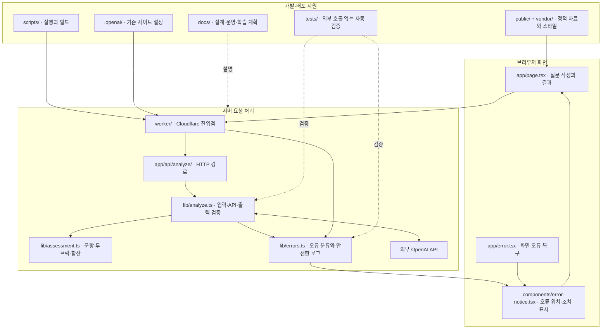
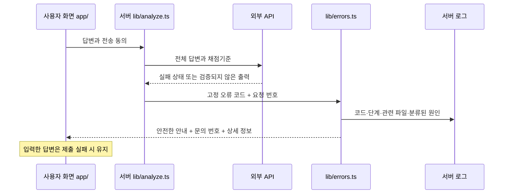

# 폴더와 실행 구조

## 실제 요청이 지나가는 폴더

이 그림은 현재 코드를 기준으로 그렸습니다. `components/ui/`, `db/`, `drizzle/`, `hooks/`, `examples/`는 배포 템플릿에서 남겨둔 지원 코드이며, 현재 검사 요청이 모두 통과하는 폴더가 아닙니다.

## 폴더별 역할

| 폴더 | 역할 | 오류 확인 지점 |
| --- | --- | --- |
| `app/` | 소개·질문·결과·레이아웃 및 API 경로 | 브라우저 연결, 응답 해석, 화면 렌더링 |
| `app/api/analyze/` | 채점 HTTP 요청 진입점 | 잘못된 JSON, 동의·문항 수·길이 검증 |
| `lib/` | 채점 파이프라인, 루브릭, 계산, 오류 분류. 연결 도구 지원 코드도 포함 | 외부 API, 결과 계약, 인용, 합산 |
| `components/` | 재사용 UI. ErrorNotice와 초기 UI 템플릿 포함 | 오류 상세 표시 |
| `worker/` | Cloudflare 요청을 애플리케이션에 전달 | 앱이 오류 응답을 만들기 전 발생한 예외 |
| `public/` | favicon 등 웹에서 직접 제공하는 파일 | 정적 파일 경로와 404 |
| `scripts/` | 의존성 설치·실행·빌드 및 Sites 지원 | 실행·빌드 터미널의 파일명과 원인 |
| `.openai/` | 기존 Sites 프로젝트 연결과 배포 설정 | 사이트 ID·배포 구성 오류 |
| `tests/` | 가짜 API 응답을 주입하는 자동 검증 | 실패한 테스트 이름과 단언 위치 |
| `docs/` | 아키텍처, 오류 운영 안내, 학습 계획, 화면 자료 | 문서와 코드의 일치 여부 |
| `vendor/` | 템플릿이 사용하는 외부 스타일과 라이선스 | CSS 로딩과 라이선스 보존 |
| `hooks/` | 초기 UI 템플릿의 재사용 훅 | 해당 훅을 실제 사용할 때 확인 |
| `db/`, `drizzle/` | 초기 DB 스키마 및 마이그레이션 지원 | 현재 검사 답변 DB 저장에는 사용하지 않음 |
| `examples/` | DB 사용 예제 | 현재 운영 API가 아님 |

`node_modules/`, `dist/`, `.wrangler/`, `.sites-runtime/`는 설치·빌드·실행 중 생성되는 자료입니다. `work/`, `outputs/`는 작업·산출물 폴더입니다. Git 관리 대상에서 제외합니다. `.env.local`은 로컬 비밀 설정으로, 공개 저장소에는 값이 없는 `.env.example`만 포함합니다.

## 오류가 전달되는 흐름

`source`는 오류를 감지하거나 점검해야 할 **코드 위치**입니다. 해당 폴더가 실제 근본 원인이라고 단정하지 않습니다. 예를 들어 `lib/analyze.ts`에서 감지한 `API_QUOTA`는 외부 계정의 잔액 문제이며, 해당 파일의 코드 결함을 뜻하지 않습니다.
