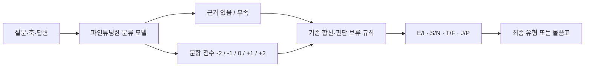

# 분류 모델로 파인튜닝하는 방향

## 결론

서술형 답변을 분류하도록 사전학습 모델을 파인튜닝하는 방향은 이 프로젝트에 적합한 실험입니다. 다만 처음부터 사용자 전체를 16유형 중 하나로 바로 분류하기보다, **문항별 채점과 근거 부족 판별**을 목표로 권장합니다. 아래는 이 서비스의 현재 루브릭에 맞춘 설계 제안이며, 아직 학습 코드를 구현하거나 성능을 확인한 상태는 아닙니다.

## 왜 16유형 직접 분류보다 문항별 채점인가

- 현재 공개한 루브릭과 비교할 수 있고, 오류가 난 문항과 축을 찾기 쉽습니다.
- 최종 유형이 같더라도 점수와 근거가 틀린 경우를 평가할 수 있습니다.
- `0점`은 양쪽이 균형인 경우와 근거가 부족한 경우를 포함하므로 `evidence`를 별도로 예측해야 합니다.
- 다섯 점수는 순서가 있는 클래스입니다. 단순 정확도 외에 MAE·가중 일치도 등을 함께 보아야 합니다.
- 전체 16유형 정확도만 최적화하면 희소 유형, 경계 응답, 근거 부족 처리가 가려질 수 있습니다.

후속 실험으로 전체 답변에서 네 개의 이진 축을 예측하는 다중 출력 분류를 비교할 수 있습니다. 이 경우에도 불확실한 입력에 강제로 네 글자를 부여하지 않는 별도 보류 정책이 필요합니다.

## 분류와 설명 생성은 다른 작업

분류 헤드는 점수나 라벨을 예측하며, 근거 문장과 자연어 해설을 자동으로 생성하지는 않습니다. 현재 UI의 `quote`와 `reason`을 유지하려면 다음 중 하나를 별도로 설계해야 합니다.

1. 작은 분류 모델 + 별도의 근거 구간 추출 및 검증된 해설 템플릿
2. LLM의 JSON 생성 방식으로 점수·인용·해설을 함께 지도 파인튜닝
3. 분류는 자체 모델, 해설은 API로 분리한 실험 구성

첫 단계에서는 **분류 품질 평가와 해설 생성 평가를 분리**하세요. 설명을 나중에 붙인다고 해서 모델이 실제 그 설명에 따라 분류했다는 인과적 증거가 되지는 않습니다.

## 해야 할 일의 순서

1. **API 기준선 확보:** 실제 검사 성공, 동일 답변의 반복 채점 변동, 요청당 비용·전체 지연을 기록합니다.
2. **라벨 정의 고정:** 문항별 `score`, `evidence`, 검토 메모, 루브릭 버전을 정합니다. 0점과 근거 부족 사례를 구분해 예시를 작성합니다.
3. **별도 동의 후 데이터 확보:** 분석용 전송 동의와 학습 활용 동의를 분리합니다. 현재 사이트는 학습 데이터를 저장하지 않습니다.
4. **사람이 검토한 테스트셋 고정:** API 라벨은 초안으로 사용하고 독립 검토합니다. 사용자·유사 응답이 학습과 테스트에 중복되지 않게 나눕니다.
5. **저렴한 기준 모델부터 비교:** TF-IDF+선형 분류기, 한국어를 지원하는 소형 인코더 분류 모델, 기본 LLM 프롬프트를 비교합니다. 큰 LLM이 반드시 필요한지 확인합니다.
6. **LLM 파인튜닝:** 분류 헤드 또는 구조화된 JSON 지도학습 중 목표를 고르고, 필요하면 LoRA로 제한된 파라미터를 학습합니다. 모델 크기·라이선스·한국어·메모리 조건은 실제 후보를 보고 결정합니다.
7. **전체 서비스 기준 비교:** 점수 MAE, macro-F1, 근거 부족 판별, 보류율·보류 후 품질, 인용 정확성, P95 지연, 성공 검사당 비용을 함께 기록합니다. 다섯 클래스의 불균형도 확인합니다.
8. **서빙과 최적화:** 결과가 유효하면 자체 추론 서버를 붙이고 동시성·메모리·유휴 비용까지 비교합니다. 분류 헤드 모델은 생성형 LLM과 서빙 방식이 다를 수 있으므로 vLLM을 미리 필수로 고정하지 않습니다.

## 평가할 수 있는 것과 없는 것

이 프로젝트에서 직접 평가할 수 있는 것은 **고정한 루브릭에 대한 채점 일치도**입니다. 이를 객관적인 “진짜 MBTI 정확도”로 해석하지 않습니다. 자기신고 유형, 사용자 공감도, 평가자 합의, 모델 간 일치는 서로 다른 지표입니다. 표본 수는 고정된 정답 숫자로 정하기보다 축·점수·근거 부족 사례의 분포와 학습 곡선을 보고 늘립니다.

## 읽을 자료

- [Hugging Face: 텍스트 분류 학습과 평가](https://huggingface.co/docs/transformers/tasks/sequence_classification)
- [Hugging Face PEFT: 모델을 위한 작업 유형](https://huggingface.co/docs/peft/package_reference/peft_types)

첫 자료는 분류 모델을 학습해 라벨을 예측하는 일반적인 절차를 제공합니다. 이 문서의 다섯 점수·근거 판별·평가 정책은 해당 절차를 현재 서비스에 맞게 적용한 제안입니다.
